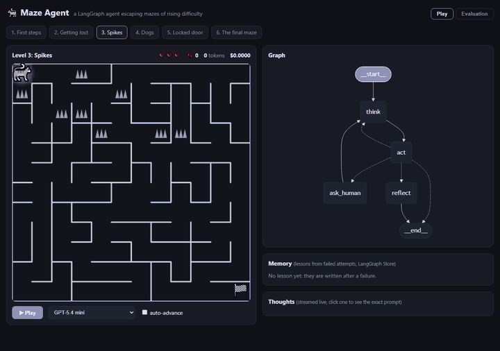
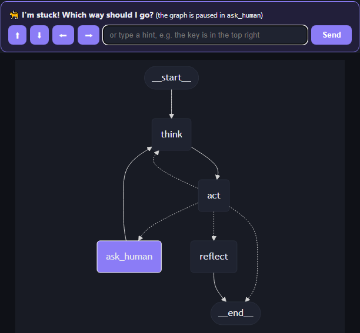

# Maze Agent

[](https://github.com/VinceBmmrt/Langraph-Maze-Resolver/actions/workflows/ci.yml) · [English](README.md) · Français

Une démo LangGraph : un chat piloté par un LLM s'échappe de 6 labyrinthes de difficulté croissante, du 7x7 au 18x18 (murs, puis pics, chiens qui patrouillent, et une porte verrouillée avec sa clé). Il apprend de ses échecs, vous demande de l'aide quand il est bloqué, et un banc d'évaluation compare les modèles.



## Lancer

```bash
cp .env.example .env        # ajoutez OPENAI_API_KEY (et ANTHROPIC_API_KEY pour Claude Haiku)
uv run uvicorn maze_agent.server:app
```

Ouvrez http://127.0.0.1:8000, choisissez un modèle et appuyez sur Play. Les niveaux s'enchaînent tout seuls.

- Terminal : `uv run python -m maze_agent --level 5 --attempts 3`
- Évaluation : `uv run python -m maze_agent.eval --models openai:gpt-5.4-mini openai:gpt-5.4-nano`
- Tests (sans clé API) : `uv run pytest`

## Le jeu

- Les labyrinthes utilisent l'algorithme « growing tree » (beaucoup de carrefours) plus quelques boucles, pour qu'on puisse contourner un danger.
- Les pics gardent les couloirs latéraux près du chemin de sortie. Les chiens patrouillent à la moitié de la vitesse du chat et ne le poursuivent jamais.
- La clé est loin du départ et de la porte : le chat doit la chercher, puis revenir.
- À chaque tour, le chat avance ou **attend**. On lui dit ce qu'il y a à côté de lui, quels chiens il entend et s'ils se rapprochent, et sa « carte mentale » lui indique l'ouverture inexplorée la plus proche.
- Chaque niveau peut être réussi sans dégâts, par construction (testé).

## Les fonctionnalités LangGraph, et où les trouver

```
START -> think -> act -> think ...           le chat explore
                      -> ask_human -> think  bloqué : interrupt() jusqu'à votre réponse
                      -> reflect -> END      échec : une leçon part dans le Store
                      -> END                 sorti
```

| Fonctionnalité | Où | Ce qu'elle fait ici |
|---|---|---|
| `StateGraph` avec un **état Pydantic** | `agent.py` `State` | Un état typé qui le reste après un rechargement de checkpoint (un simple dict transforme les tuples en listes). |
| **Reducers** (`Annotated[int, add]`) | `State.tokens`, `cost`, `incidents` | Chaque nœud ne renvoie que sa part ; LangGraph additionne tokens et dollars et ajoute les blessures à la liste. |
| **Contexte d'exécution** (`context_schema`, `Runtime[Context]`) | `Context`, tous les nœuds | Injecte le labyrinthe, le cerveau (LLM) et les options. Les tests injectent un cerveau scripté : aucune clé API en CI. |
| **Nœuds async** avec **`timeout`** et **`RetryPolicy`** par nœud | `think`, `reflect` | Un appel LLM bloqué est annulé après 30 s et relancé jusqu'à 3 fois. |
| **`Command(update=..., goto=...)`** + `destinations` | `act` | Un seul nœud met à jour l'état et choisit la suite : `think`, `ask_human`, `reflect` ou `END`. |
| **Checkpointer** (`InMemorySaver`) avec une **liste blanche** msgpack | compilation de `graph` | Chaque étape est sauvegardée ; indispensable aux interruptions. Les types maison sont autorisés explicitement. |
| **Humain dans la boucle** : `interrupt()` + `Command(resume=...)` | `ask_human`, `server.resume_run` | Quand le chat tourne en rond ou n'a plus de piste, le graphe se met en pause. Votre réponse reprend le même fil depuis son checkpoint. |
| **Mémoire long terme** : `Store` (`InMemoryStore`) via `runtime.store` | `reflect`, `think` | Après un échec, le LLM écrit une leçon ; la tentative suivante lit les 3 dernières (un espace de noms par niveau et par modèle). |
| **Streaming** : `astream(version="v2")` avec `updates` + `messages` | `runner.play` | `updates` anime le plateau ; `messages` diffuse les tokens du LLM du nœud `think`, la pensée s'écrit mot à mot. |
| **Introspection du graphe** : `get_graph().draw_mermaid()` | `/api/graph` | Le vrai graphe compilé est dessiné dans l'interface, le nœud en cours s'allume. |
| **Annulation** | `server.play_level` | Fermer la page arrête le graphe : aucun token n'est dépensé une fois que plus personne ne regarde. |
| **Tags et métadonnées** dans la config d'exécution | `runner.play` | Les exécutions sont étiquetées par niveau et modèle, prêtes pour LangSmith (`LANGSMITH_TRACING=true`). |



Côté LangChain : `init_chat_model` (n'importe quel fournisseur à partir d'un identifiant) et `with_structured_output(method="json_schema")` (sortie structurée native : une `Decision` avec la pensée d'abord, puis la direction).

## Évaluation

`maze_agent/eval.py` fait jouer chaque modèle sur chaque niveau, par chaînes de 3 tentatives au plus ; chaque tentative lit les leçons des échecs précédents. Il mesure le taux de réussite au premier essai et après apprentissage, les pas comparés à l'optimum, les vies perdues, et le coût par tentative et par victoire. Les résultats vont dans `evals/results.json` et s'affichent dans l'onglet **Evaluation**.

Dernière exécution : 41 parties, 2 chaînes par niveau, 3 tentatives au plus, 24.9 minutes, 3.08 $.

| Modèle | Niveau | Premier essai | Après apprentissage | Pas (optimum) | Coût par victoire |
|---|---|---|---|---|---|
| gpt-5.4-mini | 1 | 100% | 100% | 16 (12) | $0.007 |
| gpt-5.4-mini | 2 | 100% | 100% | 126 (22) | $0.054 |
| gpt-5.4-mini | 3 | 100% | 100% | 124 (26) | $0.053 |
| gpt-5.4-mini | 4 | 50% | 100% | 132 (32) | $0.160 |
| gpt-5.4-mini | 5 | 0% | 0% | – | – |
| gpt-5.4-mini | 6 | 0% | 0% | – | – |
| gpt-5.4-nano | 1 | 100% | 100% | 16 (12) | $0.002 |
| gpt-5.4-nano | 2 | 100% | 100% | 128 (22) | $0.015 |
| gpt-5.4-nano | 3 | 100% | 100% | 129 (26) | $0.015 |
| gpt-5.4-nano | 4 | 50% | 100% | 111 (32) | $0.030 |
| gpt-5.4-nano | 5 | 50% | 100% | 332 (74) | $0.062 |
| gpt-5.4-nano | 6 | 0% | 0% | – | – |

Ce qu'on en retient :
- Les niveaux 1 à 3 sont toujours gagnés. Aux niveaux 2 et 3, le chat parcourt environ 5 fois le chemin optimal : il explore sans carte.
- Niveau 4 (chiens) : 50 % au premier essai, **100 % après apprentissage**. Les leçons du Store font leur travail.
- Niveau 5 (clé et porte) : nano le gagne après apprentissage, mini jamais. Le modèle le plus petit et le moins cher fait mieux ici : il faut mesurer, pas supposer.
- Le niveau 6 n'a jamais été gagné avec 3 vies (12 tentatives). Il a maintenant 5 vies : lors d'une nouvelle mesure interrompue par la machine, mini l'a gagné du premier coup dans ses deux chaînes, tandis que nano a perdu ses 4 tentatives. Relancez `--levels 6 --update` pour mettre le tableau à jour.

## Code

| Fichier | Rôle |
|---|---|
| `maze_agent/maze.py` | génération déterministe (growing tree + boucles), recherche de chemin |
| `maze_agent/world.py` | règles des pics, chiens, clé et porte (fonctions pures) |
| `maze_agent/levels.py` | les 6 niveaux, dangers placés près du chemin mais jamais dessus |
| `maze_agent/perception.py` | ce que perçoit le chat, en texte |
| `maze_agent/brain.py` | prompts, schéma `Decision`, `LLMBrain` (`init_chat_model`) |
| `maze_agent/models.py` | catalogue des modèles et prix |
| `maze_agent/agent.py` | le graphe LangGraph |
| `maze_agent/runner.py` | joue un niveau en événements JSON (partagé par CLI, serveur et éval) |
| `maze_agent/server.py` | FastAPI + SSE natif |
| `maze_agent/eval.py` | le banc d'évaluation |
| `static/` | canvas, graphe en direct, pensées, panneaux d'aide et de mémoire, onglet d'éval |

## Configuration

`MODEL` dans `.env` fixe le modèle par défaut (`openai:gpt-5.4-mini`). Le sélecteur propose GPT-5.4 mini, GPT-5.4 nano et Claude Haiku 5.5 ; un modèle sans sa clé API est grisé.
