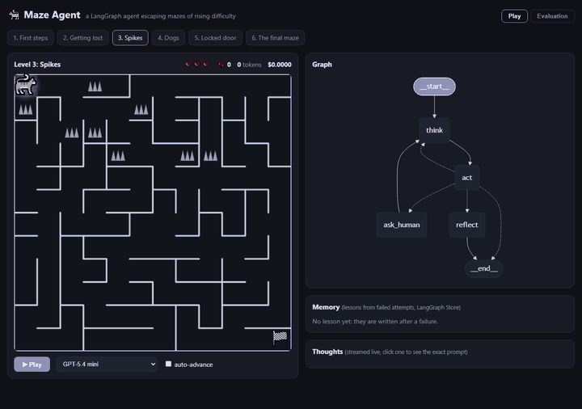
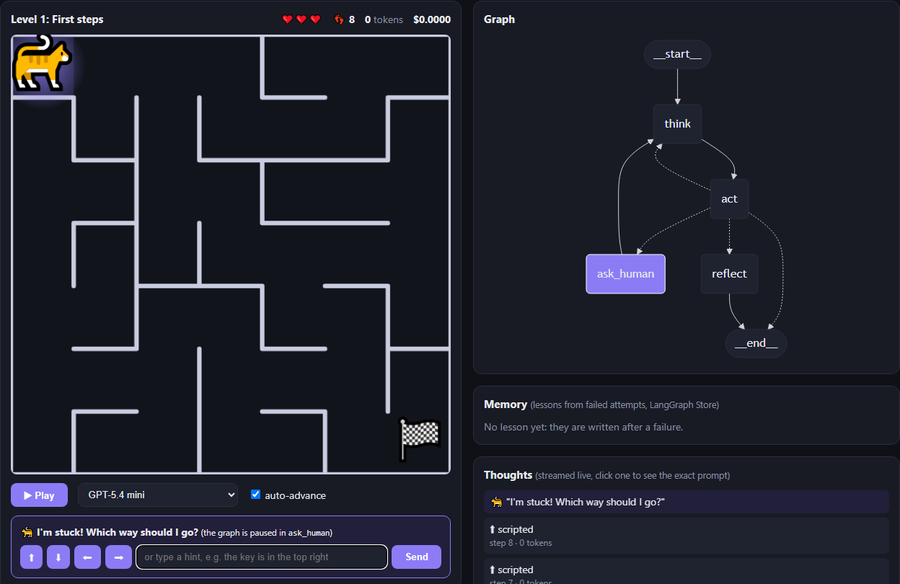

# Maze Agent

[](https://github.com/VinceBmmrt/Langraph-Maze-Resolver/actions/workflows/ci.yml) · English · [Français](README.fr.md)

A LangGraph demo: an LLM-driven cat escapes 6 mazes of rising difficulty, from 7x7 to 18x18 (walls, then spikes, patrolling dogs, and a locked door with its key). It learns from its failures, asks you for help when it is stuck, and an eval harness compares models.



## Run

```bash
cp .env.example .env        # add OPENAI_API_KEY (and ANTHROPIC_API_KEY for Claude Haiku)
uv run uvicorn maze_agent.server:app
```

Open http://127.0.0.1:8000, pick a model and press Play. Levels chain automatically.

- Terminal: `uv run python -m maze_agent --level 5 --attempts 3`
- Eval: `uv run python -m maze_agent.eval --models openai:gpt-5.4-mini openai:gpt-5.4-nano`
- Tests (no API key needed): `uv run pytest`

## The game

- Mazes use the growing-tree algorithm (many junctions) plus a few loops, so dangers can be walked around.
- Spikes guard side corridors next to the exit path. Dogs patrol at half the cat's speed and never chase.
- The key sits far from both the start and the door: the cat must search, then come back.
- Each turn the cat moves or **waits**. It is told what is next to it, which dogs it hears and whether they come closer, and a "mental map" hint toward the nearest unexplored opening.
- Every level is solvable unhurt by construction (tested).

## LangGraph features, and where to find them

```
START -> think -> act -> think ...           the cat explores
                      -> ask_human -> think  stuck: interrupt() until you answer
                      -> reflect -> END      failed: a lesson goes to the Store
                      -> END                 escaped
```

| Feature | Where | What it does here |
|---|---|---|
| `StateGraph` with a **Pydantic state** | `agent.py` `State` | Typed state that stays typed after a checkpoint reload (plain dicts turn tuples into lists). |
| **Reducers** (`Annotated[int, add]`) | `State.tokens`, `cost`, `incidents` | Each node returns only its share; LangGraph sums tokens and dollars and appends injuries. |
| **Runtime context** (`context_schema`, `Runtime[Context]`) | `Context`, every node | Injects the maze, the brain (LLM) and options. Tests inject a scripted brain: no API key in CI. |
| **Async nodes** with a node **`timeout`** and **`RetryPolicy`** | `think`, `reflect` | An LLM call that hangs is cancelled after 30 s and retried up to 3 times. |
| **`Command(update=..., goto=...)`** + `destinations` | `act` | One node both updates the state and routes to `think`, `ask_human`, `reflect` or `END`. |
| **Checkpointer** (`InMemorySaver`) with a msgpack **allowlist** | `graph` compile | Every step is saved; required for interrupts. Custom types are allowlisted explicitly. |
| **Human in the loop**: `interrupt()` + `Command(resume=...)` | `ask_human`, `server.resume_run` | When the cat circles or has no lead, the graph pauses. Your answer resumes the same thread from its checkpoint. |
| **Long-term memory**: `Store` (`InMemoryStore`) via `runtime.store` | `reflect`, `think` | After a failure the LLM writes a lesson; the next attempt reads the last 3 (one namespace per level and model). |
| **Streaming**: `astream(version="v2")` with `updates` + `messages` | `runner.play` | `updates` drive the board; `messages` stream the LLM tokens of the `think` node, so the thought appears word by word. |
| **Graph introspection**: `get_graph().draw_mermaid()` | `/api/graph` | The real compiled graph is drawn in the UI, with the running node lit up. |
| **Cancellation** | `server.play_level` | Closing the page stops the graph, so no tokens are spent once nobody is watching. |
| **Tags and metadata** in the run config | `runner.play` | Runs are tagged by level and model, ready for LangSmith (`LANGSMITH_TRACING=true`). |



From LangChain: `init_chat_model` (any provider from one id) and `with_structured_output(method="json_schema")` (native structured output: a `Decision` with the thought first, then the direction).

## Evaluation

`maze_agent/eval.py` runs every model on every level in chains of up to 3 attempts; each attempt reads the lessons of the failed ones. It reports the win rate on the first try and after learning, steps against the optimum, lives lost, and cost per attempt and per win. Results go to `evals/results.json` and show in the **Evaluation** tab.

Latest run: 41 runs, 2 chains per level, up to 3 attempts, 24.9 minutes, $3.08.

| Model | Level | First try | After learning | Steps (optimal) | Cost per win |
|---|---|---|---|---|---|
| gpt-5.4-mini | 1 | 100% | 100% | 16 (12) | $0.007 |
| gpt-5.4-mini | 2 | 100% | 100% | 126 (22) | $0.054 |
| gpt-5.4-mini | 3 | 100% | 100% | 124 (26) | $0.053 |
| gpt-5.4-mini | 4 | 50% | 100% | 132 (32) | $0.160 |
| gpt-5.4-mini | 5 | 0% | 0% | – | – |
| gpt-5.4-mini | 6 | 0% | 0% | – | – |
| gpt-5.4-nano | 1 | 100% | 100% | 16 (12) | $0.002 |
| gpt-5.4-nano | 2 | 100% | 100% | 128 (22) | $0.015 |
| gpt-5.4-nano | 3 | 100% | 100% | 129 (26) | $0.015 |
| gpt-5.4-nano | 4 | 50% | 100% | 111 (32) | $0.030 |
| gpt-5.4-nano | 5 | 50% | 100% | 332 (74) | $0.062 |
| gpt-5.4-nano | 6 | 0% | 0% | – | – |

What it shows:
- Levels 1 to 3 are always won. On levels 2 and 3 the cat walks about 5 times the optimal path: it explores without a map.
- Level 4 (dogs): 50% on the first try, **100% after learning**. The lessons from the Store do their job.
- Level 5 (key and door): nano wins it after learning, mini never does. The smaller, cheaper model is better here: measure, don't assume.
- Level 6 was never won with 3 lives (12 attempts). It now has 5 lives: in a re-run cut short by the machine, mini won it on the first try in both chains while nano lost all 4 attempts. Re-run `--levels 6 --update` to refresh the table.

## Code

| File | Role |
|---|---|
| `maze_agent/maze.py` | seeded maze generation (growing tree + loops), path search |
| `maze_agent/world.py` | spikes, dogs, key and door rules (pure functions) |
| `maze_agent/levels.py` | the 6 levels, hazards placed near the path but never on it |
| `maze_agent/perception.py` | what the cat perceives, as text |
| `maze_agent/brain.py` | prompts, `Decision` schema, `LLMBrain` (`init_chat_model`) |
| `maze_agent/models.py` | model catalog and prices |
| `maze_agent/agent.py` | the LangGraph graph |
| `maze_agent/runner.py` | runs a level as JSON events (CLI, server and eval share it) |
| `maze_agent/server.py` | FastAPI + native SSE |
| `maze_agent/eval.py` | the evaluation harness |
| `static/` | canvas, live graph, thoughts, help and memory panels, eval tab |

## Config

`MODEL` in `.env` sets the default (`openai:gpt-5.4-mini`). The picker offers GPT-5.4 mini, GPT-5.4 nano and Claude Haiku 5.5; a model without its API key is greyed out.
